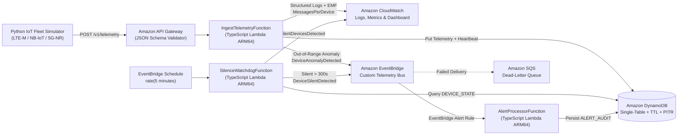

# Serverless Cellular IoT Telemetry Pipeline on AWS

[](https://github.com/psathwikaa/iot-telemetry-pipeline-aws/actions)

An end-to-end **serverless cellular IoT telemetry ingestion, real-time anomaly detection, and silent-device monitoring pipeline** built with **TypeScript**, **AWS CDK v2**, **AWS Lambda**, **Amazon API Gateway**, **Amazon DynamoDB**, **Amazon EventBridge**, **Amazon CloudWatch Embedded Metric Format (EMF)**, **Python**, and **GitHub Actions**.

---

## Why This Project Exists

In large-scale cellular IoT deployments (`LTE-M`, `NB-IoT`, `5G-NR` cold-chain logistics, smart grid sensors, and industrial asset trackers), two failure modes dominate operational risk:

1. **Out-of-Range Physical Excursions**: A refrigerated cargo container experiences a cooling failure (`temperatureC > 45°C`), a remote battery drops below critical threshold (`batteryPct < 15%`), or a transit asset experiences mechanical shock (`vibrationG > 4.0g`).
2. **Silent Device Dropouts**: A cellular device stops transmitting altogether due to radio shadow, SIM/eUICC detachment, or firmware hang—producing **zero incoming events** and bypassing traditional request-triggered alerting.

This project solves both problems on a **100% serverless, event-driven AWS architecture** defined entirely as **Infrastructure as Code (AWS CDK in TypeScript)**:

- **Simulated Nordic Cellular IoT Fleet (`simulator/device_simulator.py`)**: A deterministic Python simulator modeling 5 Nordic IoT devices across Gothenburg, Stockholm, Oslo, Malmö, and Trondheim (`LTE-M`, `NB-IoT`, `5G-NR`) with configurable out-of-range fault injection and silent-device dropouts.
- **Schema-First API Contract (`contracts/telemetry-request.schema.json`)**: Enforced at the **API Gateway edge** via JSON Schema request validation, inside the **TypeScript Ingestion Lambda** via `ajv`, and across languages via automated **Contract Tests**.
- **Single-Table DynamoDB Storage**: Persists immutable time-series telemetry history (`PK = DEVICE#<id>`, `SK = TS#<iso>#SEQ#<seq>`), real-time device heartbeat state (`PK = DEVICE_STATE`, `SK = DEVICE#<id>`), and alert audit trails (`PK = ALERT#<id>`, `SK = TS#<iso>#<alertId>`) with automatic **Time-to-Live (`expiresAt`)** and **Point-in-Time Recovery (PITR)**.
- **EventBridge Dual-Path Alerting**:
  - **Real-Time Out-of-Range Alerts**: When `IngestTelemetryFunction` detects threshold breaches, it publishes `DeviceAnomalyDetected` (`source: "iot.telemetry.ingest"`) to a custom EventBridge bus.
  - **Scheduled Silent-Device Watchdog**: An EventBridge scheduled rule (`rate(5 minutes)`) invokes `SilenceWatchdogFunction`, which scans device heartbeats and raises `DeviceSilentDetected` (`source: "iot.telemetry.watchdog"`) when a device goes silent beyond `SILENCE_THRESHOLD_SECONDS` (`300s`).
  - **Resilient Alert Routing**: An EventBridge rule routes both event types to `AlertProcessorFunction` with automatic retries (`2`) and an **SQS Dead-Letter Queue (DLQ)**.
- **CloudWatch Observability**: Emits structured JSON logs (`correlationId`, `deviceId`, `rat`, `latencyMs`) and **CloudWatch Embedded Metric Format (EMF)** documents tracking **`MessagesPerDevice`** (dimensioned by `Service` and `DeviceId`), `AnomaliesDetected`, `SilentDevicesDetected`, and `IngestionLatencyMs`.

---

## Serverless Architecture



---

## DynamoDB Single-Table Design

All three entity types share `IotTelemetryTable` (`PAY_PER_REQUEST`, `PK` + `SK`, TTL attribute `expiresAt`):

| Entity Type | Partition Key (`PK`) | Sort Key (`SK`) | Purpose & Access Pattern | Retention (TTL) |
| :--- | :--- | :--- | :--- | :---: |
| `TELEMETRY_EVENT` | `DEVICE#<deviceId>` | `TS#<isoTimestamp>#SEQ#<paddedSeq>` | Query chronological telemetry history for a specific device (`GET /v1/devices/{deviceId}/telemetry`) | `30 days` |
| `DEVICE_STATE` | `DEVICE_STATE` | `DEVICE#<deviceId>` | O(1) heartbeat shadow update on ingest; single partition query by `SilenceWatchdogFunction` to detect silent devices | Persistent |
| `ALERT_AUDIT` | `ALERT#<deviceId>` | `TS#<detectedAt>#<alertId>` | Immutable audit log of `OUT_OF_RANGE` and `DEVICE_SILENT` alerts per device | `90 days` |

---

## Operational Alert Thresholds

The rule engine in [`src/rules/anomaly-evaluator.ts`](src/rules/anomaly-evaluator.ts) evaluates every ingested frame against operational bounds:

| Metric | Normal Operating Range | Warning Threshold | Critical Threshold | Unit |
| :--- | :---: | :---: | :---: | :---: |
| `temperatureC` | `-25.0` to `45.0` | `< -25.0` or `> 45.0` | `< -35.0` or `> 55.0` | `°C` |
| `humidityPct` | `10.0` to `90.0` | `< 10.0` or `> 90.0` | `< 5.0` or `> 95.0` | `%` |
| `batteryPct` | `15.0` to `100.0` | `< 15.0` | `< 7.0` | `%` |
| `vibrationG` | `0.0` to `4.0` | `> 4.0` | `> 8.0` | `g` |
| `network.rssiDbm` | `-115.0` to `-30.0` | `< -115.0` | `< -125.0` | `dBm` |

---

## Observability: Structured Logs & CloudWatch EMF (`MessagesPerDevice`)

Every telemetry ingestion emits both a structured JSON log record and a **CloudWatch Embedded Metric Format (EMF)** document via [`src/observability/telemetry-logger.ts`](src/observability/telemetry-logger.ts). CloudWatch automatically extracts the custom metrics without requiring synchronous `PutMetricData` API calls:

```json
{
  "_aws": {
    "Timestamp": 1793642940000,
    "CloudWatchMetrics": [
      {
        "Namespace": "IotTelemetryPipeline",
        "Dimensions": [
          ["Service", "DeviceId"],
          ["Service", "Rat"],
          ["Service"]
        ],
        "Metrics": [
          { "Name": "MessagesPerDevice", "Unit": "Count" },
          { "Name": "AnomaliesDetected", "Unit": "Count" },
          { "Name": "IngestionLatencyMs", "Unit": "Milliseconds" }
        ]
      }
    ]
  },
  "Service": "iot-telemetry-pipeline",
  "DeviceId": "iot-se-gbg-001",
  "Rat": "LTE-M",
  "MessagesPerDevice": 1,
  "AnomaliesDetected": 0,
  "IngestionLatencyMs": 1.42,
  "correlationId": "sim-iot-se-gbg-001-seq-1"
}
```

---

## Project Structure

```text
iot-telemetry-pipeline-aws/
├── .github/workflows/ci.yml              # GitHub Actions: Lint, Tests, SCA Security Scan, CDK Synth
├── bin/
│   └── app.ts                            # AWS CDK application entrypoint
├── contracts/
│   └── telemetry-request.schema.json     # Canonical Draft-07 JSON Schema for POST /v1/telemetry
├── infra/
│   └── iot-telemetry-stack.ts            # AWS CDK Stack (API GW, 3 Lambdas, DynamoDB, EventBridge, CW)
├── simulator/
│   ├── __init__.py
│   ├── device_simulator.py               # Python cellular IoT fleet simulator (CLI + HTTP client)
│   ├── requirements.txt                  # Python test & SCA dependencies
│   └── tests/
│       └── test_simulator.py             # Python unit & cross-language contract test suite
├── src/
│   ├── events/
│   │   └── alert-publisher.ts            # EventBridge PutEvents adapter & InMemoryEventBus
│   ├── handlers/
│   │   ├── ingest-telemetry.ts           # API Gateway Lambda handler (ingest + out-of-range detection)
│   │   ├── silence-watchdog.ts           # Scheduled Lambda handler (silent-device detection)
│   │   └── alert-processor.ts            # EventBridge target Lambda handler (alert audit persistence)
│   ├── observability/
│   │   └── telemetry-logger.ts           # Structured JSON logger & CloudWatch EMF metric emitter
│   ├── rules/
│   │   └── anomaly-evaluator.ts          # Threshold rule evaluator (WARNING / CRITICAL severity)
│   ├── storage/
│   │   └── telemetry-repository.ts       # DynamoDB DocumentClient repository & InMemory adapter
│   ├── types/
│   │   └── telemetry.ts                  # Domain interfaces & DynamoDB/EventBridge record types
│   ├── validation/
│   │   └── contract-validator.ts         # AJV JSON Schema validator for API requests
│   └── local-runner.ts                   # End-to-end local pipeline runner consuming simulator frames
├── tests/
│   ├── contract/
│   │   └── telemetry-contract.test.ts    # Contract tests for POST /v1/telemetry request schema
│   ├── infra/
│   │   └── iot-telemetry-stack.test.ts   # AWS CDK Template assertions (DynamoDB, EventBridge, API GW)
│   ├── integration/
│   │   └── pipeline.integration.test.ts  # Full flow test: Ingest -> DynamoDB -> EventBridge -> Alerts
│   └── unit/
│       └── anomaly-and-observability.test.ts # Unit tests for rules, CloudWatch EMF, and handlers
├── cdk.json
├── eslint.config.mjs
├── package.json
├── tsconfig.json
└── vitest.config.ts
```

---

## Quick Start & Verification

### 1. Install Dependencies
```bash
npm install
```

### 2. Run Unit, Contract, Integration & CDK Infrastructure Tests
```bash
# Run all TypeScript test suites (Unit + Contract + Integration + AWS CDK Assertions)
npm test

# Run Python simulator unit & contract test suite
python -m unittest discover -s simulator/tests -v
```

### 3. Run the Simulated IoT Fleet & Local Serverless Pipeline
```bash
# 1. Generate 4 rounds of telemetry from 5 Nordic IoT devices (with anomaly + silent device injection)
python -m simulator.device_simulator --rounds 4 --seed 42 --output reports/simulation_run.json

# 2. Feed simulated frames through the TypeScript Lambda + EventBridge + Watchdog pipeline
npx ts-node src/local-runner.ts
```
This produces:
- `reports/simulation_run.json`: All 17 transmitted cellular IoT frames (`LTE-M`, `NB-IoT`, `5G-NR`).
- `reports/pipeline_execution_report.json`: Final DynamoDB device states, detected silent devices (`iot-no-osl-003`), and persisted `OUT_OF_RANGE` (`iot-se-gbg-001`) + `DEVICE_SILENT` (`iot-no-osl-003`) alert audit records.
- `reports/cloudwatch_logs_and_emf.jsonl`: Structured JSON logs and CloudWatch EMF `MessagesPerDevice` metric payloads.

### 4. Send Simulated Telemetry to a Live AWS API Gateway Endpoint
```bash
python -m simulator.device_simulator \
  --endpoint https://<api-id>.execute-api.eu-north-1.amazonaws.com/v1/telemetry \
  --rounds 10
```

### 5. Synthesize or Deploy the AWS CDK Stack
```bash
# Synthesize CloudFormation template to cdk.out/
npx cdk synth

# Deploy to AWS account
npx cdk deploy
```
